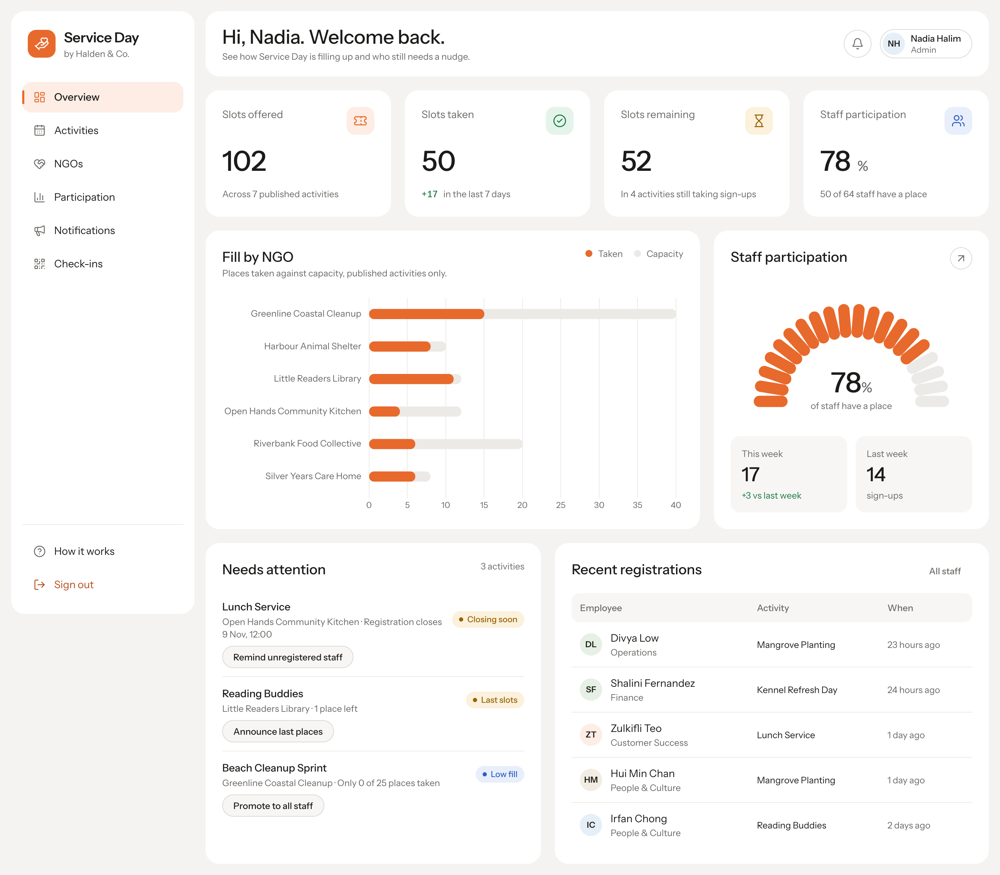

# Service Day

Service Day is a web application for Halden & Co.'s annual corporate volunteering day. Employees choose one NGO activity, can switch or withdraw until the activity's cut-off, and check in on the day with a QR code. Administrators manage NGOs and activities, monitor participation, send reminders and broadcasts, and record attendance.

Built for BIT306 Web Technologies, Assignment 1 (front-end): **Angular 22** with NgModules, plain CSS with Flexbox, and a **json-server** mock REST API. Assignment 2 adds an Express/MongoDB back-end behind the same front-end.



## Features by role

**Employee** (`/app`)
- Home: your place, the cut-off, what you can still change, closing-soon activities, latest notices
- Opportunities: search, filter by type and date, live slot meters (updated every 10 s)
- Register, switch and withdraw, with slot and cut-off rules and an overbooking guard
- My registrations with full history; notifications inbox and bell
- QR / code check-in on the day

**Administrator** (`/admin`)
- Overview: KPIs, Fill by NGO chart, participation gauge, "needs attention", recent sign-ups
- Activities: create, edit, publish, unpublish, cancel (participants are notified), delete with rules
- NGOs: create, edit, delete (blocked while an NGO has activities)
- Participation: by department and NGO, staff without a place, one-click reminders
- Notification centre: reminder schedule with preview, broadcasts, history
- Check-ins: QR code and printable poster, live arrivals (5 s), attendance CSV export

**Both:** sign in, employee self-registration (`@halden.co` emails only), responsive layout down to 390 px, keyboard and screen-reader support (WCAG 2.2 AA).

## Quick start

Requires Node.js 22.22.3+, 24.15+ or 26 and npm.

```bash
git clone https://github.com/Masatoooo/Service-Day.git
cd Service-Day
npm install
npm run dev
```

Open <http://localhost:4200>. The mock API runs on <http://localhost:3000>.

Demo accounts (also listed on the sign-in page):

| Account | Password | Role |
|---|---|---|
| `admin@halden.co` | `Admin#2026` | Admin |
| `aisha.rahman@halden.co`, `daniel.koh@halden.co`, `priya.menon@halden.co`, `marcus.tan@halden.co` | `Volunteer#1` | Employees |

To start again with fresh demonstration data (dates are relative to today): stop `npm run dev`, run `npm run db:reset`, then `npm run dev` again.

## Documentation

| Document | Contents |
|---|---|
| [docs/SETUP.md](docs/SETUP.md) | Installation and configuration manual, LAN mode for phone scanning, troubleshooting, switching to the Assignment 2 API |
| [docs/USER-MANUAL.md](docs/USER-MANUAL.md) | Step-by-step use of the employee and administrator modules, with screenshots |
| [docs/REPORT-NOTES.md](docs/REPORT-NOTES.md) | Technologies, MVC mapping, front-end, AJAX and modules evidence for the report |
| [docs/VIDEO-SCRIPT.md](docs/VIDEO-SCRIPT.md) | Scene-by-scene script for the demonstration video |
| [docs/PLAN.md](docs/PLAN.md) · [docs/PROGRESS.md](docs/PROGRESS.md) | Build plan and development log |
| [DESIGN.md](DESIGN.md) · [PRODUCT.md](PRODUCT.md) | Visual design system and product context |

## Scripts

| Command | Purpose |
|---|---|
| `npm run dev` | Seed the data if missing, start the API (3000) and the app (4200) |
| `npm run db:reset` | Recreate the demonstration data |
| `npm run dev:lan` | Same as `dev`, reachable from a phone on the same Wi-Fi (see SETUP §6) |
| `npm run build` | Production build into `dist/service-day/` |
| `npm test` | Unit tests (Vitest) |

The mock API stores passwords in plain text in `mock-api/db.json`; this is acceptable only for this prototype and is replaced by a real server in Assignment 2.
