# Service Day — User Manual

Service Day is Kaneko.co's web application for its annual corporate volunteering day. Employees choose one NGO activity, keep or change their place until the activity's cut-off, and check in on the day. Administrators manage NGOs and activities, monitor participation, send notices, and record attendance.

This manual is organised by module, matching the application's structure:

- **Shared functionality** (both roles): signing in, creating an account, the application layout, notifications.
- **Employee module** (`/app`): use cases UC2 (view opportunities), UC3 (register, switch, withdraw), UC5 (inbox) and UC6 (check in).
- **Administrator module** (`/admin`): use cases UC1 (manage NGOs and activities), UC4 (monitor participation), UC5 (notifications and reminders) and UC6 (QR check-in and attendance).

The steps use the demonstration accounts listed in `docs/SETUP.md` §5 (password `Volunteer#1` for employees, `Admin#2026` for the administrator). Reset the data before following the manual: stop the servers, run `npm run db:reset`, then `npm run dev`.

---

## Part A — Shared functionality

### A1. Sign in

**Purpose.** Open the area that matches your role: employees go to their Home page, administrators to the Overview.

**Steps.**
1. Open `http://localhost:4200`. Signed-out visitors are taken to the sign-in page.
2. Enter your work email and password. Select the eye icon to show or hide the password.
3. Select **Sign in**.
4. (Demonstration) Open **Demo accounts** below the form and select **Use** next to an account to fill both fields.

**Expected result.** You arrive on your home page with the greeting "Hi, {first name}. Welcome back." If the email is unknown, the message under the email field reads "We couldn't find an account with that email."; if the password is wrong, "That password doesn't match." Your session is remembered after a page reload; the password itself is never stored in the browser.

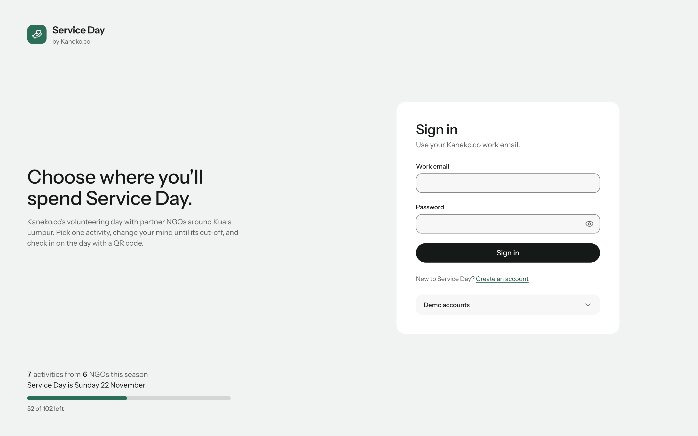
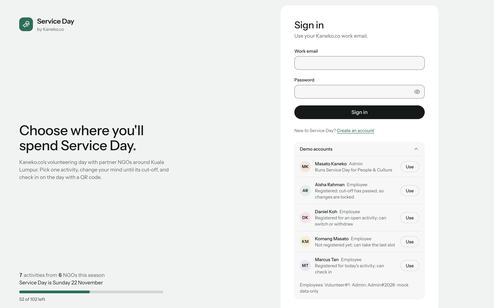

### A2. Create an employee account

**Purpose.** New staff members register themselves. Administrator accounts cannot be created here.

**Steps.**
1. On the sign-in page select **Create an account**.
2. Enter your full name, your work email (it must end in `@kaneko.co`), your department, and a password of at least 8 characters that contains a number. Type the password again to confirm it.
3. Select **Create account**.

**Expected result.** You are signed in and taken to the employee Home page. Each field explains a problem in its own words, for example "Use your Kaneko.co email, ending in @kaneko.co.", "Add at least one number." or "An account with this email already exists. Sign in instead." (checked against the server while you type).

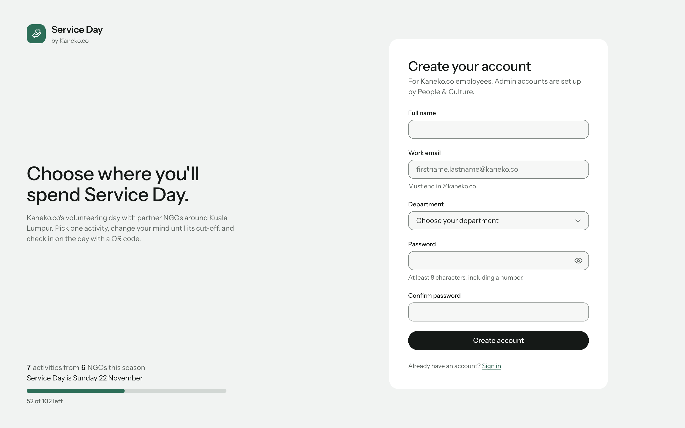
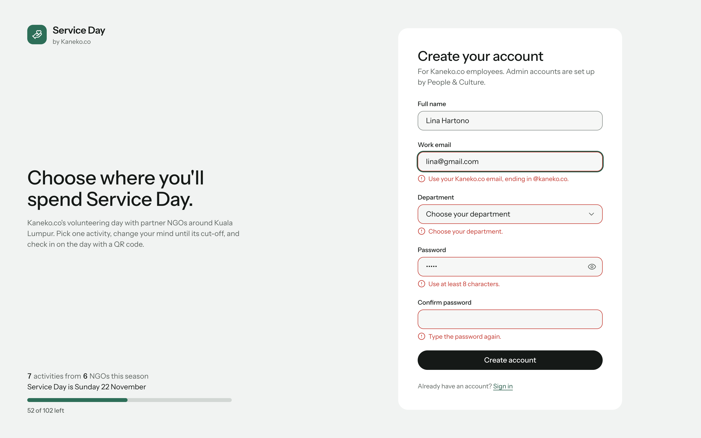

### A3. The application layout

**Purpose.** Know where everything is.

- **Sidebar** (left): the pages of your area, "How it works" (a short explanation of the rules), and **Sign out**. Below 900 px wide the sidebar is hidden; open it with the menu button (☰) in the top bar.
- **Top bar**: the page title, the notification bell, and your name with your department (or "Admin").
- **Keyboard**: press Tab once on any page to reveal **Skip to content**; every action can be reached with Tab, Enter and Escape.

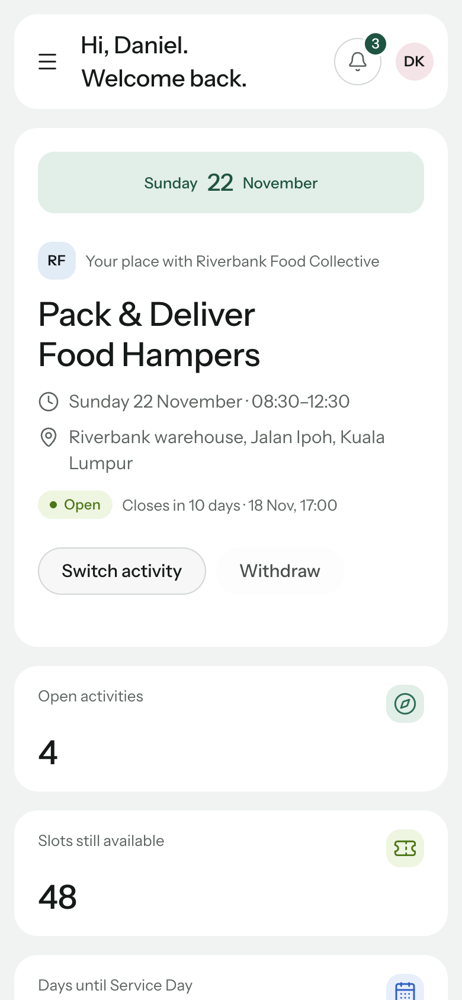
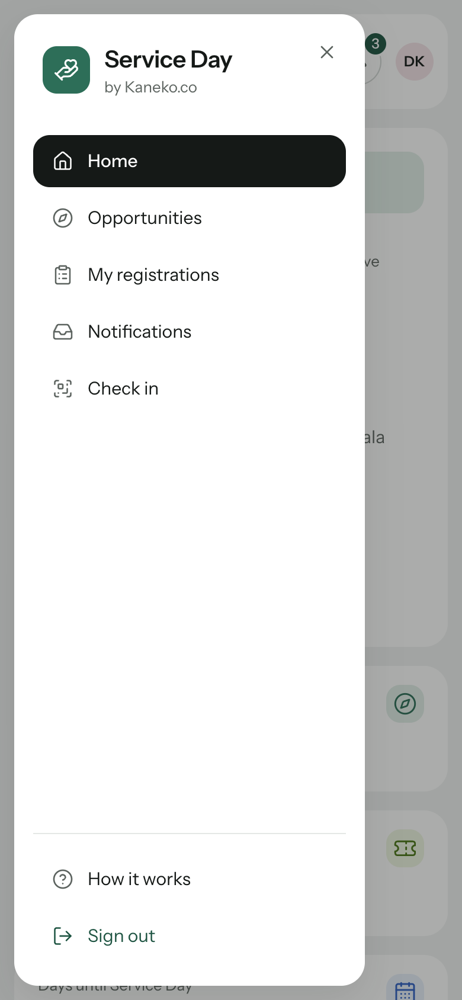

### A4. Notifications (bell)

**Purpose.** See new notices from anywhere in the employee area.

**Steps.**
1. The bell in the top bar shows the number of unread notices (sign in as Aisha Rahman to see 3).
2. Select the bell to open the five latest notices. Urgent notices are marked "Urgent" with a red icon.
3. Select **Mark all as read**, or **Open all notifications** to go to the inbox (see B6).

**Expected result.** The badge updates by itself every 15 seconds; when an administrator sends a broadcast it appears without reloading the page. For administrators the bell opens the Notification centre (see C7).

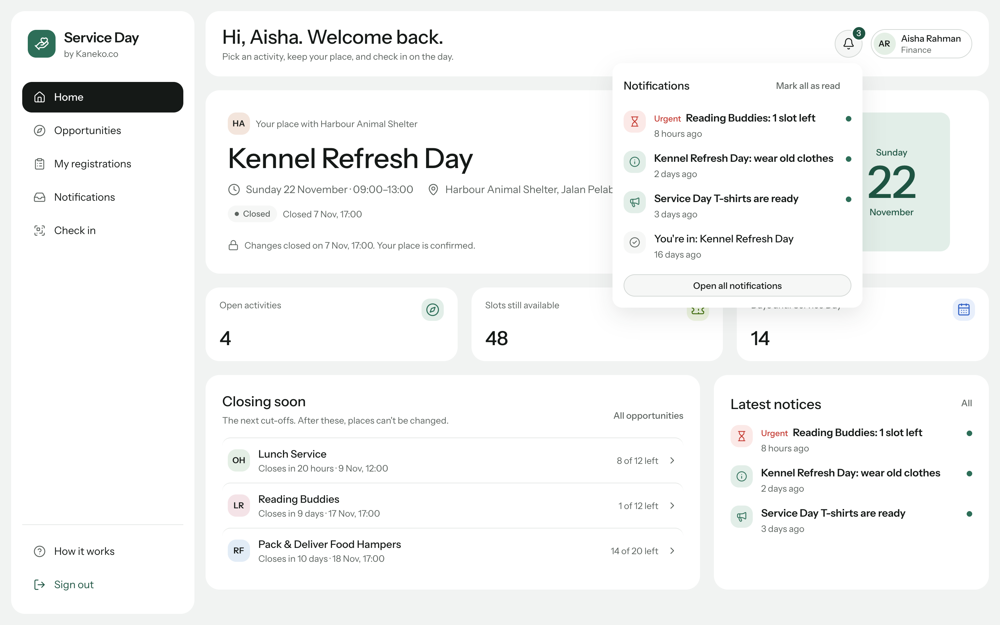

### A5. Theme (light and dark)

The application currently ships with the light theme only. A dark theme was planned (PLAN Phase 10) and has been postponed; there is no theme switch in this version.

---

## Part B — Employee module

### B1. Home

**Purpose.** See at a glance where you stand for Service Day.

**Steps.** Sign in as an employee. Home opens automatically.

**Expected result.**
- **Your Service Day** card: your activity, NGO, date and time, location, availability, the cut-off ("Closes in 10 days · 18 Nov, 17:00") and what you may do: **Switch activity** and **Withdraw** before the cut-off, or a sentence explaining why changes are locked. On the day of your activity a **Check in** button appears (sign in as Marcus Tan); after checking in it reads "Checked in at …".
- If you have no place yet, the card says how many activities still have places and offers **Browse opportunities**.
- Three key numbers: open activities, slots still available, days until Service Day.
- **Closing soon**: the next three cut-offs. **Latest notices**: your three newest notices.

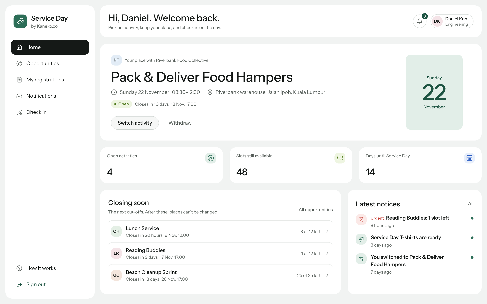
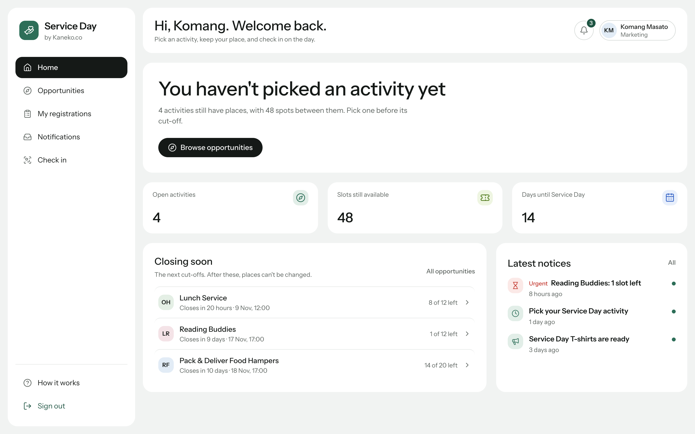
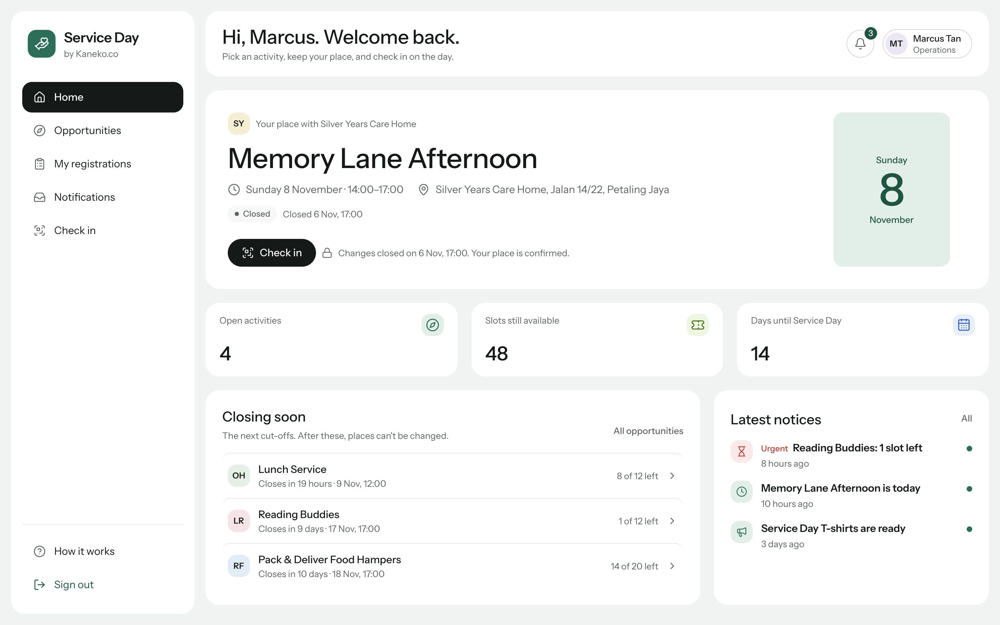

### B2. Browse and filter opportunities (UC2)

**Purpose.** Find an activity that suits you.

**Steps.**
1. Select **Opportunities** in the sidebar.
2. Type in the search box (activity, NGO or place), pick a service type pill, choose a date, or change the order (**Soonest cut-off** / **Most slots left**).
3. Turn on **Show full & closed** to include activities that can no longer be joined.

**Expected result.** Each card shows the NGO, an availability pill (Open, Last slots, Closing soon, Full, Closed), the date and place, the **slot meter** ("1 of 12 left") and the cut-off. The list updates every 10 seconds without reloading. The filters are kept in the address bar, so a refresh or a shared link shows the same selection. If nothing matches, the page suggests the smallest change that brings results back.

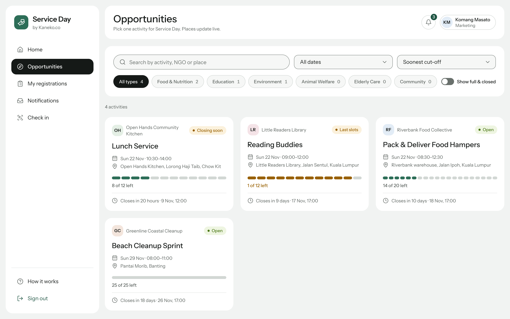
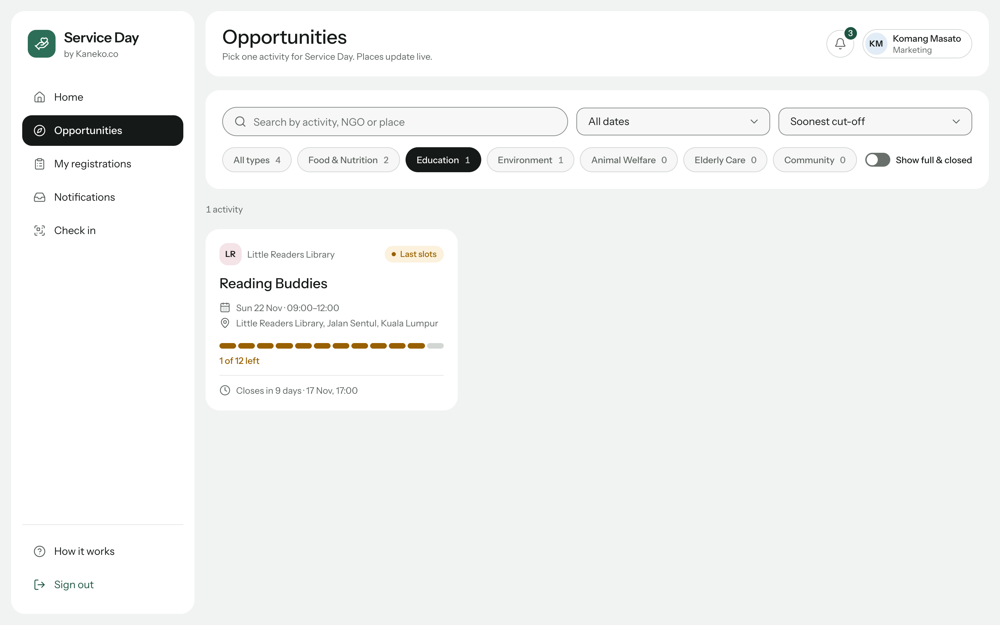
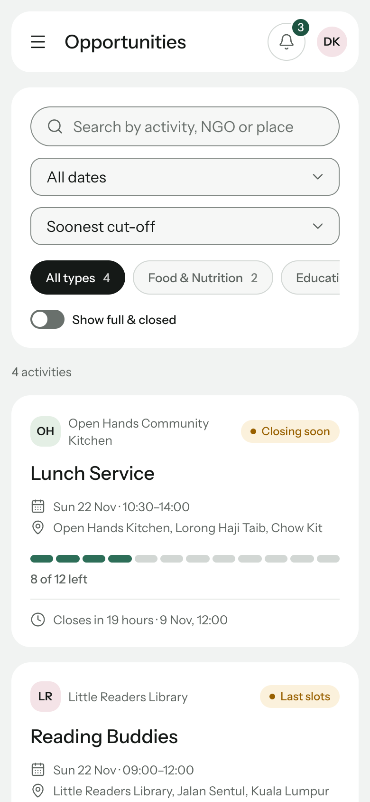

### B3. Register for an activity (UC3)

**Purpose.** Take a place. Each employee holds one place per Service Day.

**Steps.**
1. Sign in as Komang Masato, open **Opportunities**, select **Reading Buddies** (1 place left).
2. Read the details, the NGO block and **How registration works**.
3. Select **Register**. The dialog summarises the date, time, place and the cut-off.
4. Select **Register** in the dialog.

**Expected result.** A message confirms "You're in: Reading Buddies, …", the page shows "You're registered here", the slot meter changes to **Full**, and a confirmation notice appears in your notifications. If another person took the last place a moment earlier, the message reads "Someone just took the last slot. The list has been refreshed." and no place is created (overbooking guard). Buttons that cannot be used say why, for example "Registration closed on 7 Nov, 17:00." or "All slots are taken."

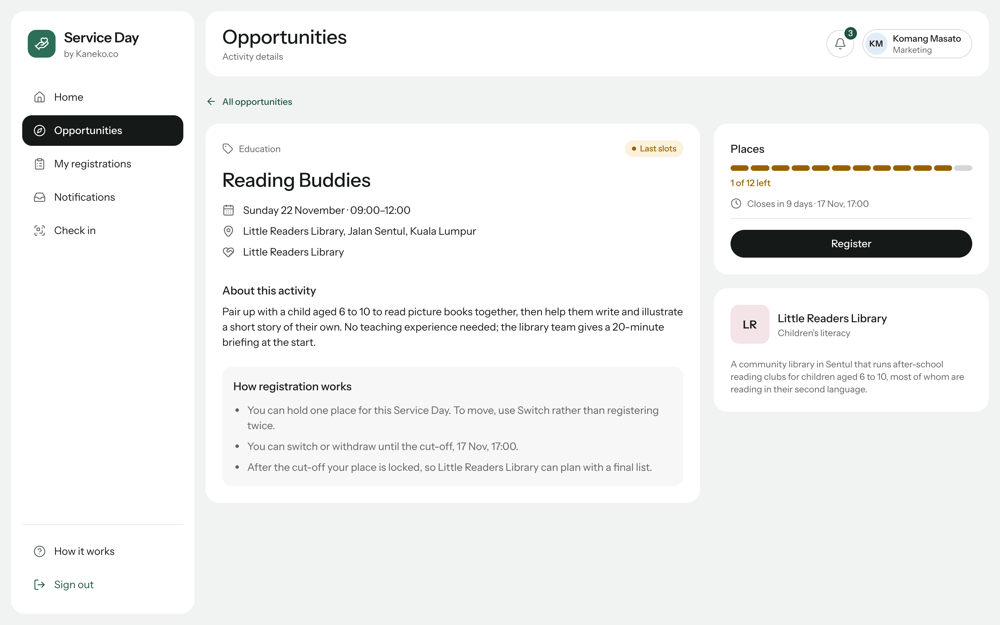
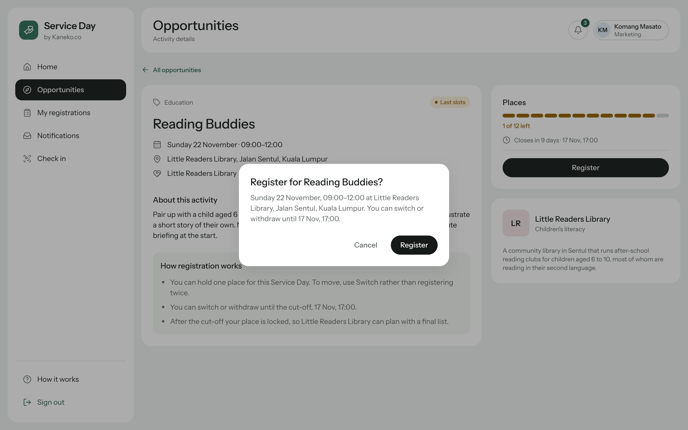

### B4. Switch to another activity (UC3)

**Purpose.** Move your place to a different activity before the cut-off.

**Steps.**
1. Sign in as Daniel Koh and open **Lunch Service**.
2. Select **Switch to this activity**. The dialog states exactly what changes ("You'll leave Pack & Deliver Food Hampers and join Lunch Service").
3. Select **Switch**.

**Expected result.** Your place moves; the old activity gets its place back; **My registrations** lists the old place as "Switched". Switching is not possible when your current activity's cut-off has passed or the new activity is full or closed; the reason is shown instead.

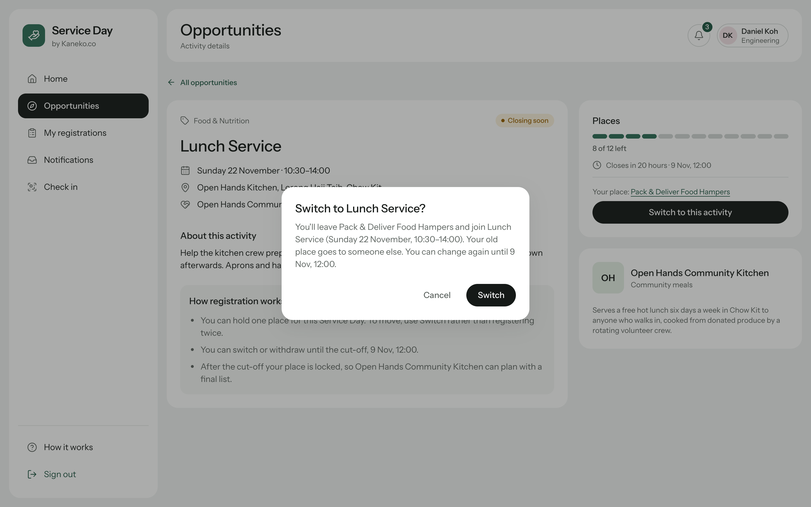

### B5. Withdraw and review your registrations (UC3)

**Purpose.** Give up your place, and see your history.

**Steps.**
1. Select **My registrations** (sign in as Daniel Koh).
2. Select **Withdraw**. The dialog explains that the place will be released for someone else.
3. Confirm with **Withdraw**.

**Expected result.** The current place disappears, the slot returns to the activity, and the history lists the change as "Withdrawn" with its date and time. After the cut-off the page reads, for example, "Changes closed on 7 Nov, 17:00. Your place is confirmed." (sign in as Aisha Rahman).

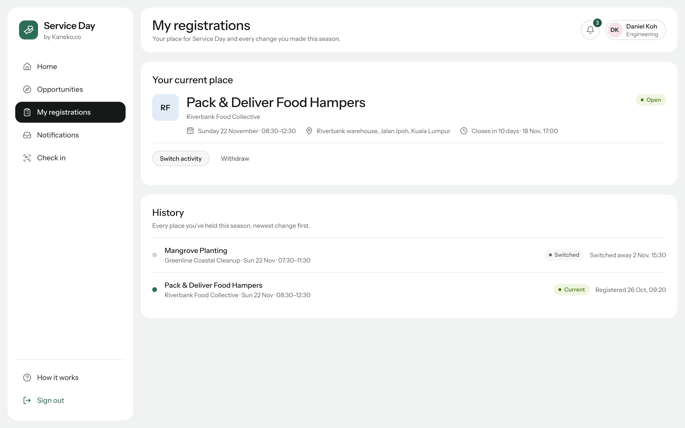
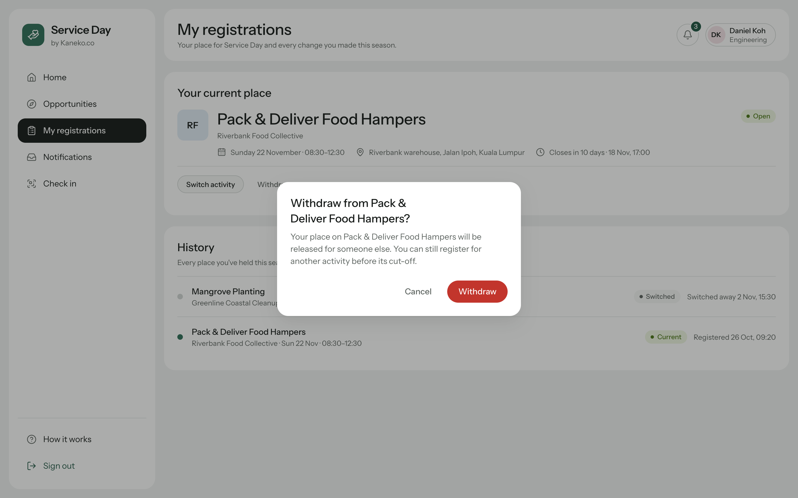
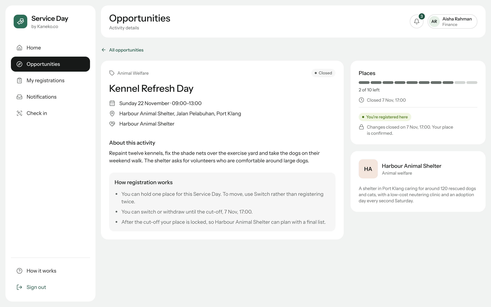

### B6. Notifications inbox (UC5)

**Purpose.** Read confirmations, reminders and announcements.

**Steps.**
1. Select **Notifications** in the sidebar (sign in as Aisha Rahman).
2. Switch between **All** and **Unread**.
3. Select **Mark as read** under a notice, or **Mark all as read** at the top.

**Expected result.** Notices are listed newest first with a type icon, the message and the time; unread ones have a dot and urgent ones a red icon with the word "Urgent". The heading changes to "You're all caught up" when nothing is unread.

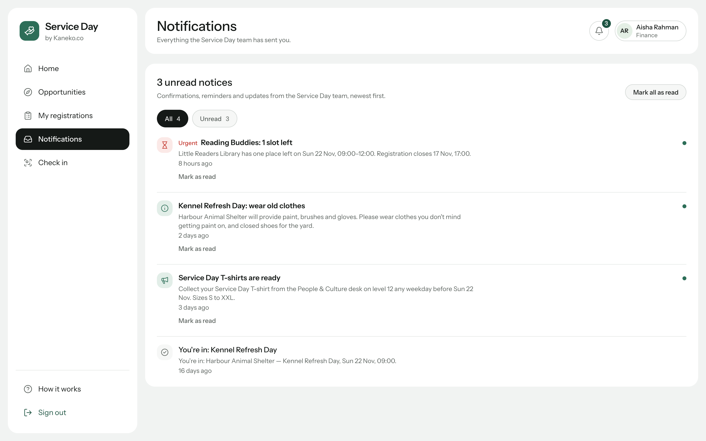

### B7. Check in on the day (UC6)

**Purpose.** Tell the Service Day team you have arrived.

**Steps (QR code).** At the venue, scan the QR code with your phone and sign in if asked. The check-in happens immediately.

**Steps (code).**
1. Select **Check in** in the sidebar (or the **Check in** button on Home), signed in as Marcus Tan.
2. Type the 8 characters printed under the QR code (for the demonstration: `EQPC2U3D`; lower case and a dash are accepted).
3. Select **Check in**.

**Expected result.** "You're checked in" with the activity and your arrival time; arrivals more than 15 minutes after the start are marked late. A second attempt shows "You're already checked in" with the time. Specific reasons are shown for an unknown code, an activity you are not registered for, too early, or too late.

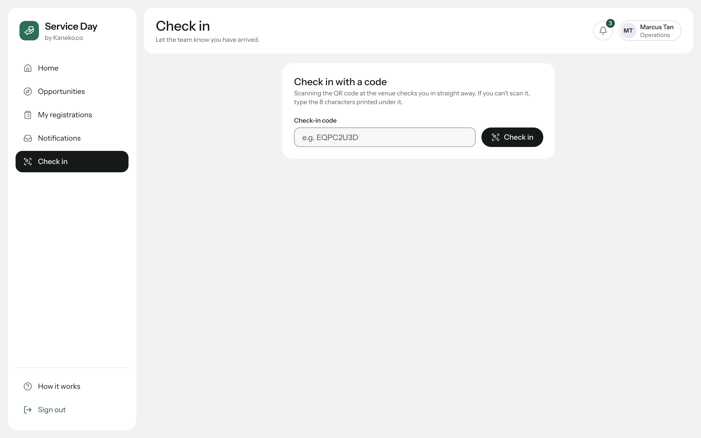
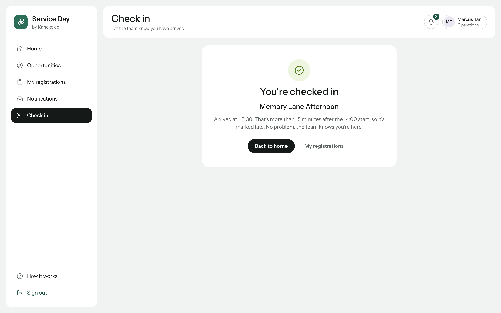
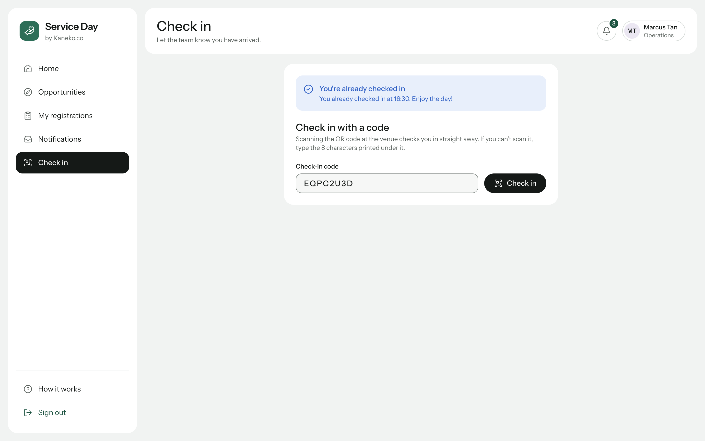

---

## Part C — Administrator module

Sign in as Masato Kaneko (`masato@kaneko.co` / `Admin#2026`) for every step in this part.

### C1. Overview (UC4)

**Purpose.** See how Service Day is filling up and what needs action.

**Expected result.**
- **Key numbers**: slots offered, slots taken (with sign-ups in the last 7 days), slots remaining, and staff participation (e.g. "78 %, 50 of 64 staff have a place").
- **Fill by NGO**: a bar chart of places taken against capacity for each NGO.
- **Staff participation** gauge with this week's and last week's sign-ups.
- **Needs attention**: activities closing within 48 hours, with their last places, or under a quarter full with more than 7 days left. Each has a one-click follow-up that opens a prepared broadcast (C7).
- **Recent registrations**: the five newest sign-ups.

All figures refresh every 10 seconds; a registration made by an employee appears without reloading.

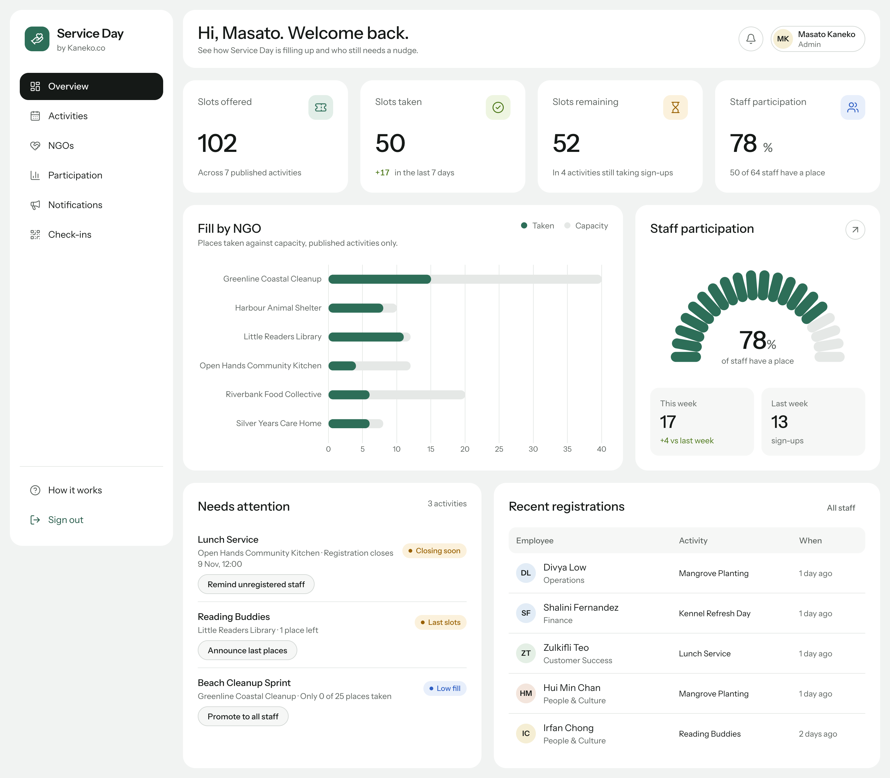

### C2. Manage activities (UC1)

**Purpose.** See every activity of the season and change its status.

**Steps.**
1. Select **Activities**. Use the search box and the status, NGO and type filters.
2. **Publish** a draft so employees can see it, or use the **⋯** menu of a row for **Unpublish**, **Cancel activity…** or **Delete…**.

**Expected result.** Published changes reach employees within 10 seconds. Deleting is refused while people are registered, with the reason and the alternative "Cancel activity instead"; cancelling notifies every registered person and releases their places. Unpublishing is offered only when nobody is registered.

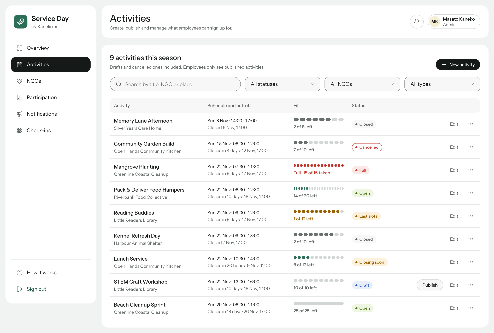
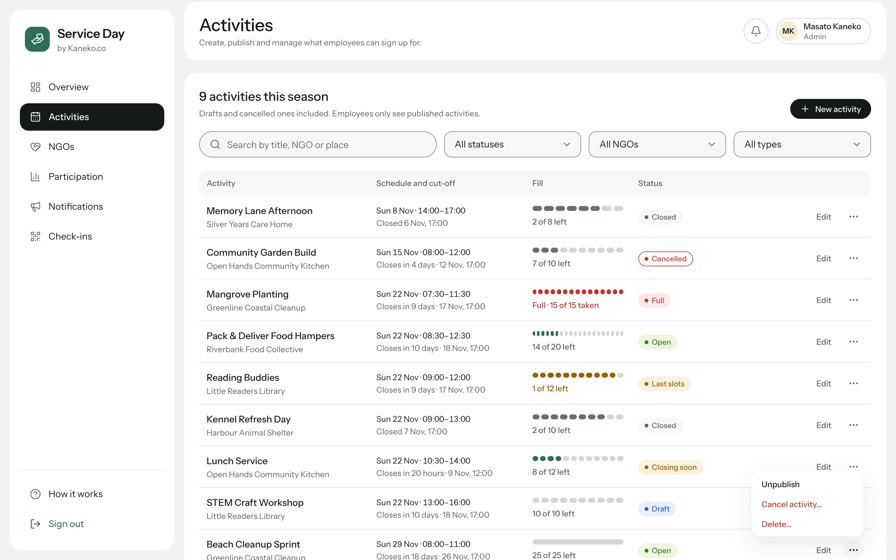
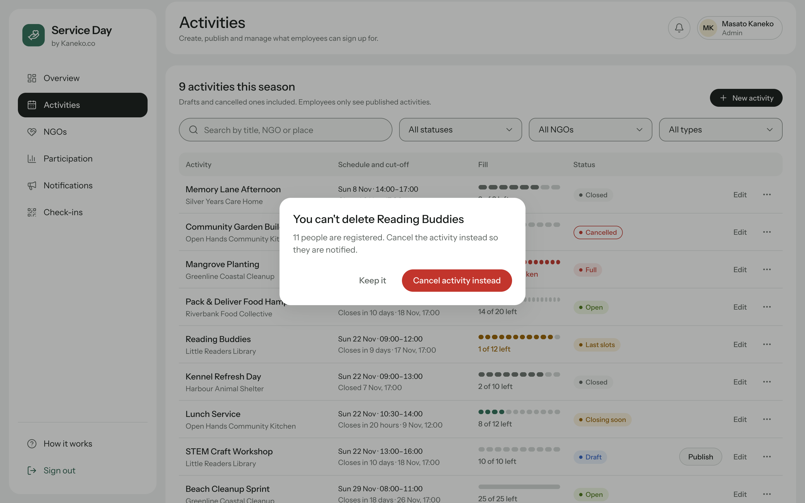
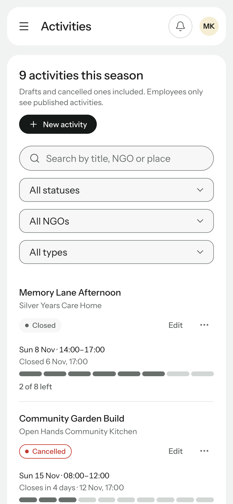

### C3. Create or edit an activity (UC1)

**Purpose.** Publish what employees can sign up for.

**Steps.**
1. Select **New activity**, or **Edit** on a row.
2. Fill in **Basics** (NGO, service type, title, description, location), **Schedule** (date, start, end), **Capacity & cut-off** (maximum slots, the date and time registration closes) and **Visibility** (Draft or Published).
3. Select **Create activity** or **Save changes**.

**Expected result.** Each problem is explained next to its field: "The end time must be after the start time (09:00).", "The cut-off must be before the activity starts (…).", or, when editing, "Max slots can't go below the 11 people already registered." (checked against the server). Leaving the page with unsaved changes asks for confirmation. When a published activity with participants changes its name, date, time, place, cut-off or description, the participants receive one notice listing what changed.

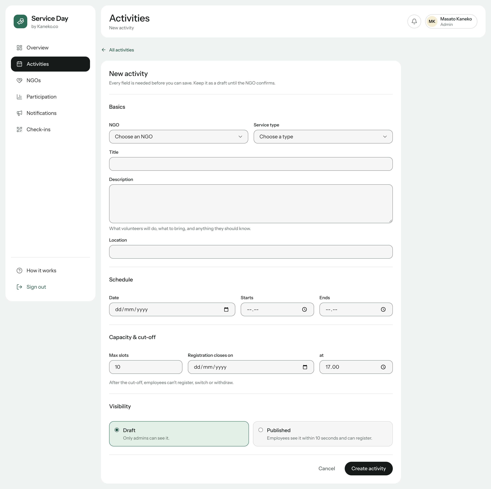
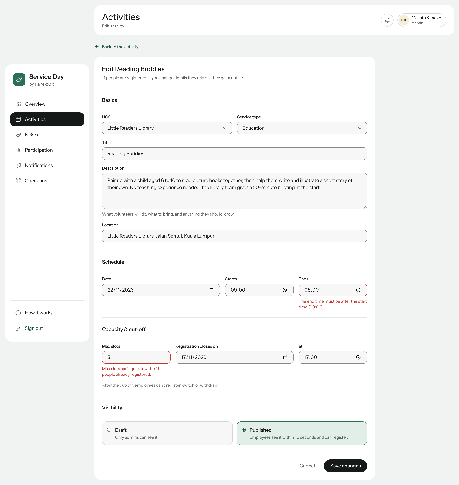

### C4. Activity details and participants (UC1, UC4)

**Purpose.** See who is coming to one activity.

**Steps.** Select an activity's title in the Activities list (e.g. **Memory Lane Afternoon**).

**Expected result.** The details, the slot meter with registered / places left / checked in, and the participant list with department, registration time and check-in status (On time, Late, Not yet). **Notify participants** opens a broadcast to exactly these people; **Open check-in** opens C8 for this activity.

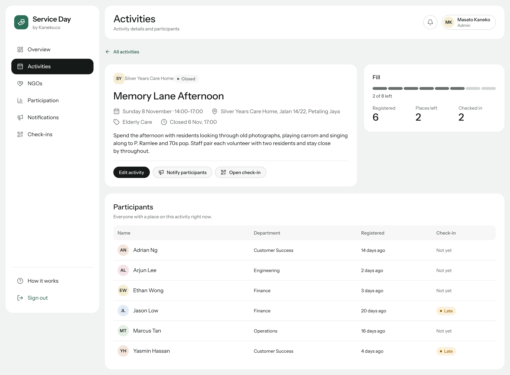

### C5. Manage NGOs (UC1)

**Purpose.** Keep the list of partner organisations up to date.

**Steps.**
1. Select **NGOs**.
2. Select **New NGO** or **Edit**; fill in the name, focus area, description, contact person, contact email and the "Verified partner" switch in the side panel; select **Add NGO** / **Save NGO**.
3. Select **Delete** on an NGO.

**Expected result.** The list shows each NGO's focus, contact, verification and number of activities. Deleting an NGO that still has activities is refused ("This NGO still has 1 activity. Delete or move them first."); *Brightside Repair Café* has none and can be deleted.

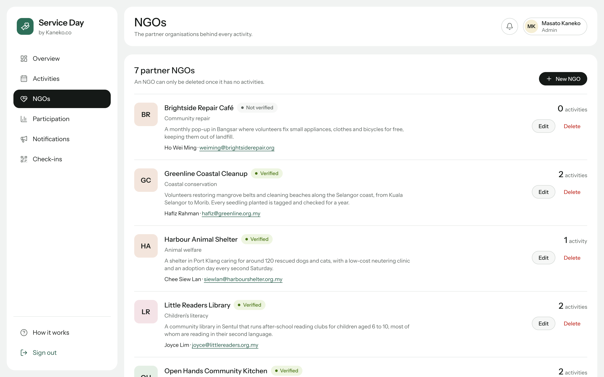
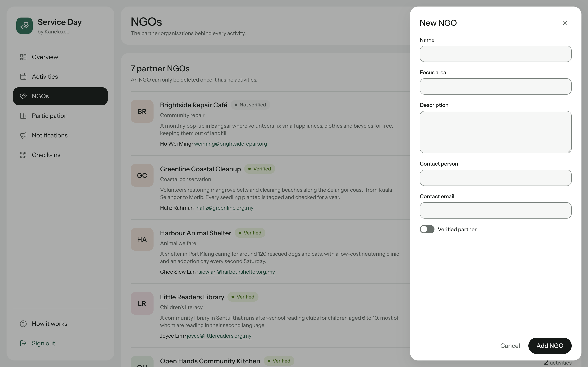

### C6. Participation and reminders (UC4, UC5)

**Purpose.** Find out who has not signed up yet and remind them.

**Steps.**
1. Select **Participation**.
2. Read the distribution by department and by NGO.
3. In **people have no place yet**, search or tick the people to remind (or the box in the header to select everyone shown).
4. Select **Send reminder (n)** and confirm.

**Expected result.** Each selected person receives a personal reminder with the number of places still open; it appears in their notifications at once and in the admin History as one entry with its number of recipients. The utilisation table lists every published activity, fullest first.

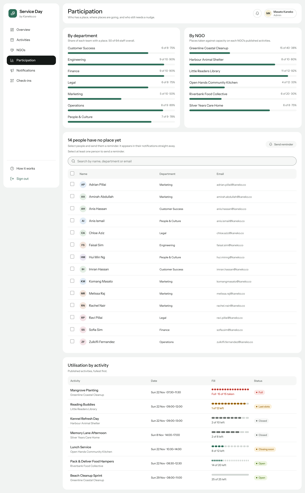
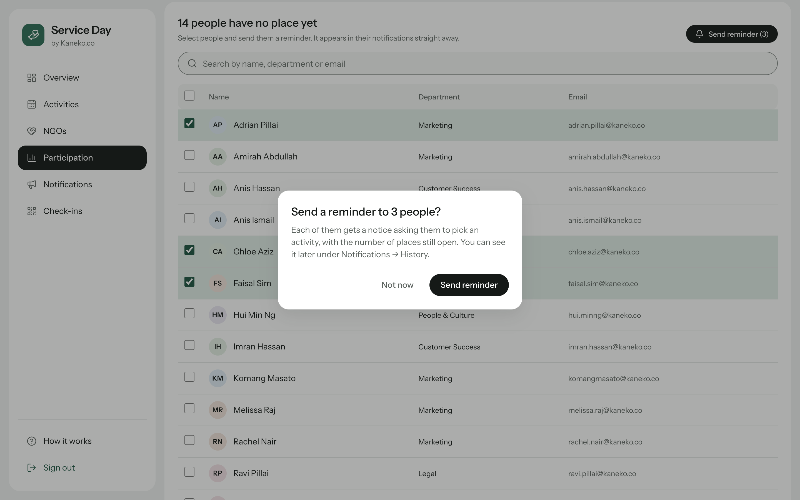

### C7. Notification centre (UC5)

**Purpose.** Plan reminders, send announcements and review everything sent.

**Steps — Schedule.**
1. Select **Notifications** → **Schedule**.
2. Turn reminders on or off, add or remove the days before an activity (default 7, 3 and 1), set the sending time and the "last slots" threshold.
3. Select **Save schedule**.

**Expected result.** The **Next reminders** list on the right updates while you edit, before saving. In this version reminders are previewed rather than sent automatically.

**Steps — Broadcast.**
1. Select **Broadcast**. Choose the audience: all staff, staff without a place, the participants of one activity, or one NGO contact.
2. Write a title and a message (up to 500 characters; a counter is shown) and optionally mark it urgent.
3. Check the inbox preview and the number of recipients, select **Review and send**, then **Send now**.

**Expected result.** A message confirms how many people received it; the History tab opens. Broadcasts to unregistered staff or to an activity's participants create one personal copy per recipient.

**Steps — History.** Select **History** and filter by type.

**Expected result.** Every notice sent so far, by the system or by an administrator, with its audience, number of recipients and sender.

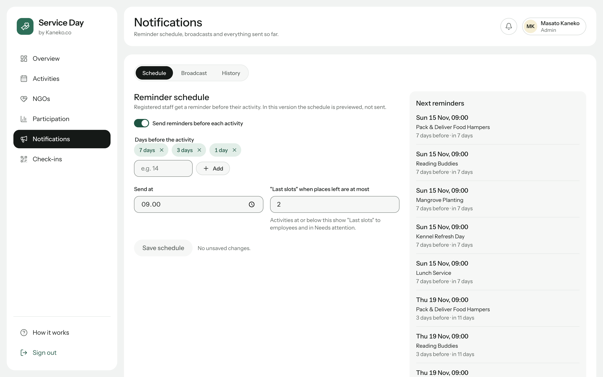
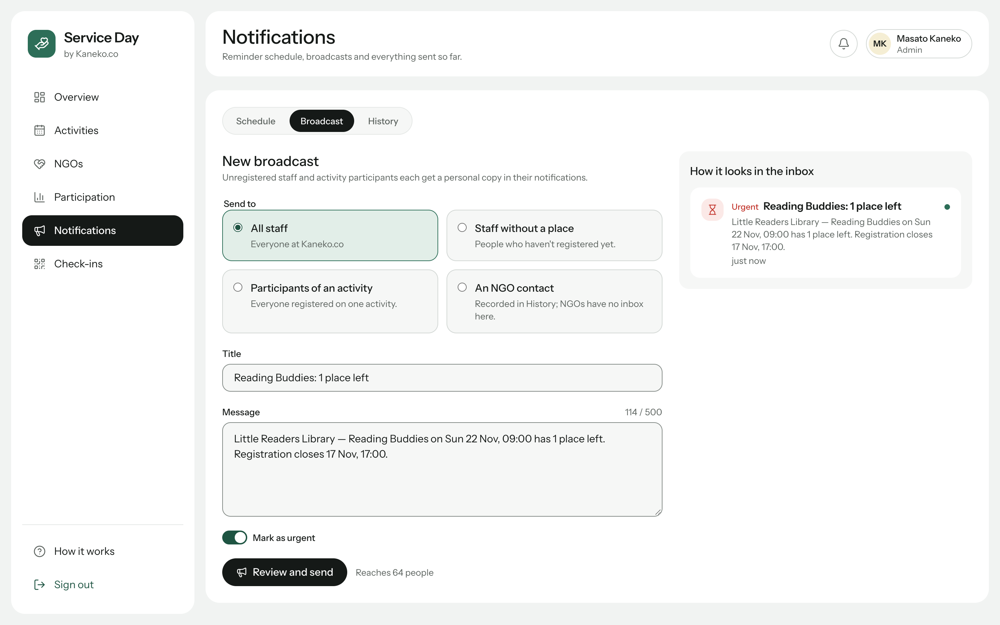
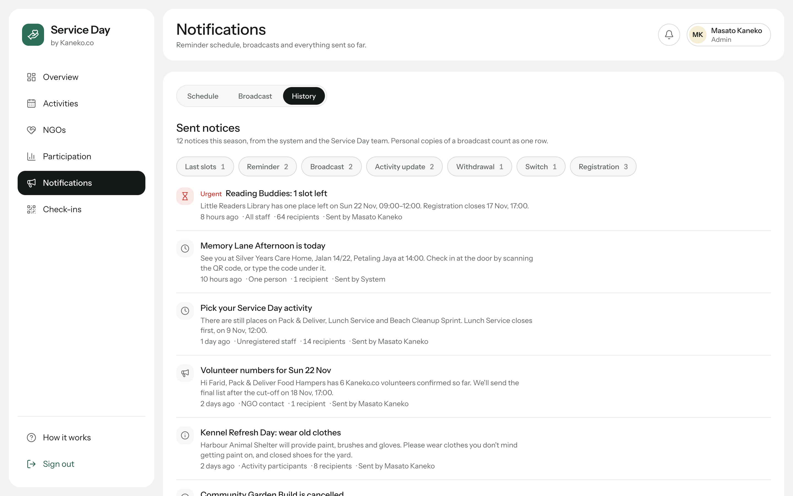

### C8. QR check-in and attendance (UC6)

**Purpose.** Let volunteers check in at the venue and record attendance.

**Steps.**
1. Select **Check-ins**. Today's activities are listed first in the picker.
2. If the activity has no code, select **Generate code**. **Download PNG** saves a printable poster with the QR code and the 8-character code; **Copy link** copies the check-in address; **Regenerate** replaces the code after a confirmation (the old code stops working; existing check-ins are kept).
3. Watch **Arrivals** while volunteers check in.
4. Select **Export CSV** to download the attendance list.

**Expected result.** The counters (present, expected, not arrived, late) and the list update every 5 seconds without reloading. The CSV file contains name, email, department, activity, registration time, check-in time and status, and opens in Excel or Numbers.

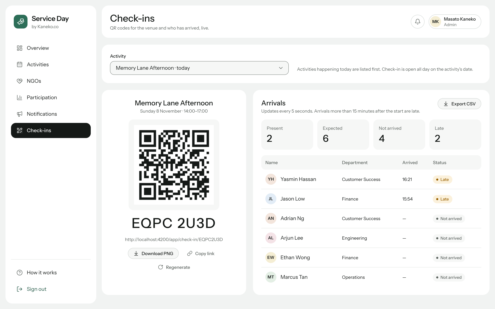
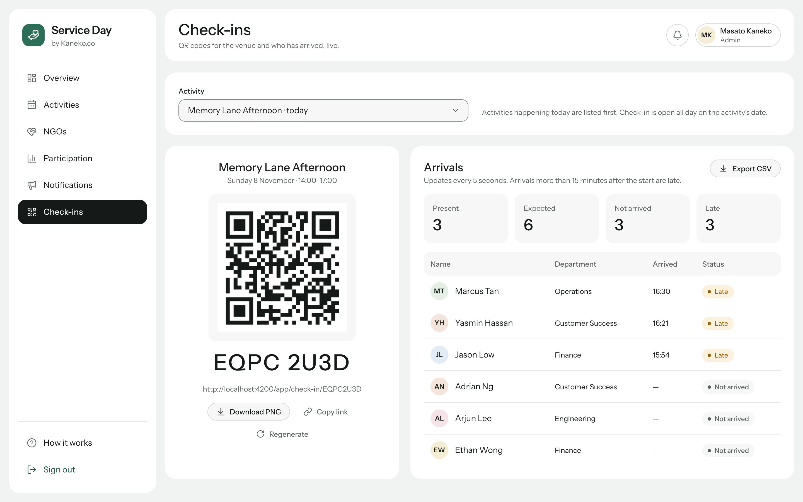

---

## Appendix — Screenshot list

All screenshots are in `docs/screenshots/` and were captured at 1440 × 900 (phone shots at 390 × 844, both at 2× pixel density) on freshly seeded data, in the order below. Only the last group changes data (Marcus checks in), so it was captured last.

| File | Route | Account | Data state / action |
|---|---|---|---|
| `login.png` | `/login` | signed out | — |
| `login-demo-accounts.png` | `/login` | signed out | "Demo accounts" opened |
| `register.png` | `/register` | signed out | empty form |
| `register-errors.png` | `/register` | signed out | name filled, `lina@gmail.com`, password `short`, Create account pressed |
| `employee-home-no-place.png` | `/app` | Komang Masato | not registered |
| `opportunities.png` | `/app/opportunities` | Komang Masato | default filters |
| `opportunities-filtered.png` | `/app/opportunities?type=Education` | Komang Masato | Education pill |
| `activity-detail-register.png` | `/app/opportunities/act-reading-buddies` | Komang Masato | 1 of 12 left |
| `register-confirm.png` | same | Komang Masato | Register dialog open (not confirmed) |
| `employee-home.png` | `/app` | Daniel Koh | registered for Pack & Deliver |
| `switch-confirm.png` | `/app/opportunities/act-lunch-service` | Daniel Koh | Switch dialog open |
| `my-registrations.png` | `/app/registrations` | Daniel Koh | current place + history |
| `withdraw-confirm.png` | `/app/registrations` | Daniel Koh | Withdraw dialog open |
| `activity-detail-locked.png` | `/app/opportunities/act-kennel-refresh` | Aisha Rahman | cut-off passed |
| `inbox.png` | `/app/inbox` | Aisha Rahman | 3 unread |
| `bell-dropdown.png` | `/app` | Aisha Rahman | bell opened |
| `admin-overview.png` | `/admin` | Masato Kaneko | full page |
| `admin-activities.png` | `/admin/activities` | Masato Kaneko | full page |
| `admin-activity-menu.png` | `/admin/activities` | Masato Kaneko | ⋯ menu of Beach Cleanup Sprint |
| `admin-delete-blocked.png` | `/admin/activities` | Masato Kaneko | Delete… on Reading Buddies |
| `admin-activity-form.png` | `/admin/activities/new` | Masato Kaneko | empty form |
| `admin-activity-form-errors.png` | `/admin/activities/act-reading-buddies/edit` | Masato Kaneko | max slots 5, end 08:00 |
| `admin-activity-detail.png` | `/admin/activities/act-memory-lane` | Masato Kaneko | 6 participants, 2 checked in |
| `admin-ngos.png` | `/admin/ngos` | Masato Kaneko | — |
| `admin-ngo-drawer.png` | `/admin/ngos` | Masato Kaneko | New NGO panel open |
| `admin-participation.png` | `/admin/participation` | Masato Kaneko | full page |
| `admin-reminder-confirm.png` | `/admin/participation` | Masato Kaneko | 3 people selected, confirm open |
| `admin-schedule.png` | `/admin/notifications?tab=schedule` | Masato Kaneko | default schedule |
| `admin-broadcast.png` | `/admin/notifications?tab=broadcast&preset=last-slots&activityId=act-reading-buddies` | Masato Kaneko | prefilled "last places" broadcast |
| `admin-history.png` | `/admin/notifications?tab=history` | Masato Kaneko | — |
| `admin-check-ins.png` | `/admin/check-ins` | Masato Kaneko | Memory Lane Afternoon, 2 arrived |
| `mobile-home.png` | `/app` (390 px) | Daniel Koh | — |
| `mobile-menu.png` | `/app` (390 px) | Daniel Koh | menu drawer open |
| `mobile-opportunities.png` | `/app/opportunities` (390 px) | Daniel Koh | — |
| `mobile-admin-activities.png` | `/admin/activities` (390 px) | Masato Kaneko | — |
| `employee-home-check-in.png` | `/app` | Marcus Tan | today's activity, Check in button |
| `check-in-code.png` | `/app/check-in` | Marcus Tan | empty code field |
| `check-in-success.png` | `/app/check-in/EQPC2U3D` | Marcus Tan | **writes** the check-in |
| `check-in-already.png` | `/app/check-in/EQPC2U3D` | Marcus Tan | second attempt |
| `admin-check-ins-arrived.png` | `/admin/check-ins` | Masato Kaneko | 3 arrived (after the next 5 s poll) |

To capture them again, reset the data, start `npm run dev`, and follow the table from top to bottom.
